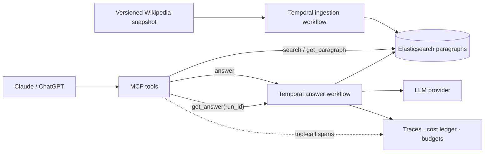

# Evidence-Backed Answers for AI Assistants — One-Pager

Source: [Notion](https://app.notion.com/p/3f40e6d73ef4812ba493ec6a5014aae6)

A reproducible test bench for measuring how retrieval and agent design affect answer quality, cost and reliability, exposed to AI assistants through MCP.

## Objective

This project shows senior backend depth on AI integrations, and is a way to learn by building. It demonstrates search, durable workflows, observability and budget enforcement behind Claude and ChatGPT.

**The deliverable is a reusable test bench and the experiments I run on it.** As I explore new topics and literature, I will turn selected ideas into testable questions. Each write-up starts with a finding, then provides the configuration, evidence, traces and limitations needed to reproduce it.

## Problem

A correct-looking answer does not establish that retrieval worked. Citations may not support the claims beside them, familiar facts may mask retrieval failures, and interrupted agent runs can obscure both failure causes and cost. The bench measures answer correctness, evidence support and operational reliability separately.

## How I will use the bench

The first milestone is one question flowing end to end: an assistant calls the service, the backend retrieves evidence, produces and checks an answer, and returns citations with a trace and cost breakdown. This establishes a working baseline and demonstrates the backend capabilities.

Future experiments will come from topics and literature I explore. For each, I will define the question, baseline, change under test and relevant measures, then save the corpus version, model, prompts, tool configuration and budgets with the results. Dataset size, repeat counts and analysis methods belong to that experiment's protocol; the bench supplies the common execution and measurement infrastructure.

## System and scope

The initial corpus is a fixed KILT Wikipedia snapshot; private content is a future extension. Ingestion assigns stable, versioned paragraph IDs in Elasticsearch. Temporal runs the server-side answer workflow, with OpenTelemetry traces and a cost ledger.

The proposed `answer` tool returns a run ID immediately; `get_answer(run_id)` returns status and, on completion, a structured result with `short_answer`, `explanation`, `citations`, usage and a trace link. Hosts may also synthesize from `search` and `get_paragraph`; server instrumentation covers those tool calls, while host reasoning and total host spend require separate telemetry.

## What the bench records and checks

- **Answer quality:** return `short_answer`, `explanation` and `citations` separately. Check the answer and explanation against cited paragraphs. For benchmark runs, score the short answer against gold answers and measure evidence retrieval; preserve KILT Wikipedia and paragraph identifiers and define how indexed chunks match provenance. Audit verifier judgments on a fixed sample.
- **Durability and observability:** link each request to its workflow history, retrieved paragraphs, prompts, outputs, latency and cost. Persist completed activity outputs and use idempotency where supported. Demonstrate recovery from a worker interruption and report duplicate or unresolved provider calls. Workflow-history replay and a fresh model run are distinct operations.
- **Economics and budgets:** record cost per answer, separating token usage and infrastructure overhead. Reserve budget before dispatch, reconcile actual usage, and stop new work at limits. Abstain when a supported answer cannot be completed; report overruns and in-flight-call exposure.

Counterfactual tests, more detailed claim verification, concurrency tests and comparisons of agent patterns can be added as future investigations require them.

## A simple end-to-end example

**Question:** “When did Arthur's Magazine begin publication?”

1. **Call:** Claude calls `answer` with the question and a budget. The MCP server starts a Temporal workflow and returns a run ID.
2. **Retrieve:** the workflow searches Elasticsearch and fetches a paragraph from the versioned Wikipedia snapshot giving the year 1844. It records the paragraph ID and text used.
3. **Answer and check:** the workflow produces `short_answer`: “1844”, an `explanation`: “Arthur's Magazine began publication in 1844”, and a citation to the paragraph. A verifier checks that the evidence supports the answer; if it cannot establish support, the workflow abstains.
4. **Return:** Claude polls `get_answer(run_id)` and shows the answer and citation. The result includes usage and a trace link so the retrieval, model calls, verification and cost can be inspected.

**First milestone:** this complete path works, a worker-interruption demonstration shows recovery behavior, and the run's evidence, trace and cost are inspectable. This is an illustrative flow, not a measured experimental result.
